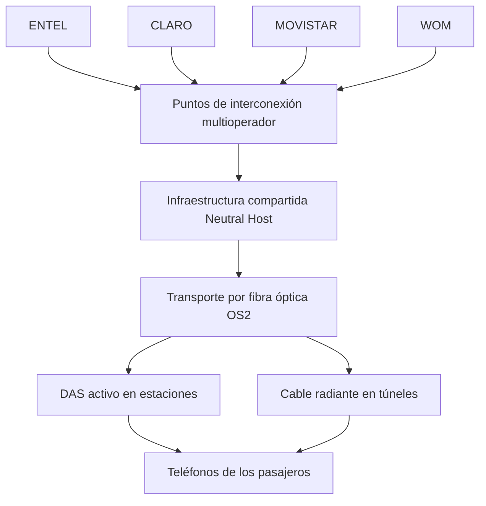
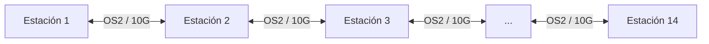

<div align="center">

# 🚇 LÍNEA 9 · METRO DE SANTIAGO

### Infraestructura de telecomunicaciones 4G/5G Neutral Host

**Proyecto Capstone · PTY4624 · Ingeniería en Conectividad y Redes · Duoc UC**


**Una infraestructura compartida. Cuatro operadores. Conectividad móvil durante el trayecto.**

</div>

---

## 📑 Contenido

1. [Resumen del proyecto](#-resumen-del-proyecto)
2. [Problema y objetivo](#-problema-y-objetivo)
3. [Cómo funciona Neutral Host](#-cómo-funciona-neutral-host)
4. [Arquitectura propuesta](#-arquitectura-propuesta)
5. [Backbone óptico](#-backbone-óptico)
6. [Ingeniería de radiofrecuencia](#-ingeniería-de-radiofrecuencia)
7. [Separación del tráfico por operador](#-separación-del-tráfico-por-operador)
8. [Indicadores de servicio y SLA](#-indicadores-de-servicio-y-sla)
9. [Metodología y Carta Gantt](#-metodología-y-carta-gantt)
10. [Entregables técnicos](#-entregables-técnicos)
11. [Validación y límites del diseño](#-validación-y-límites-del-diseño)
12. [Equipo](#-equipo)

---

## 📡 Resumen del proyecto

Esta propuesta de título desarrolla el **diseño de una infraestructura de telecomunicaciones subterránea para la futura Línea 9 del Metro de Santiago**. Su finalidad es distribuir la cobertura móvil **4G/5G de ENTEL, CLARO, MOVISTAR y WOM** dentro de estaciones, andenes y túneles, utilizando un modelo **Neutral Host**.

En lugar de instalar una infraestructura de radiodistribución independiente para cada compañía, se propone **compartir elementos de la infraestructura del Metro** —según las condiciones técnicas de integración— y mantener **separado el transporte correspondiente a cada operador**.

| Parámetro | Alcance de referencia del proyecto |
|:--|:--|
| Trazado estudiado | Aproximadamente **27 km** |
| Estaciones consideradas | **14** |
| Entorno | Estaciones y túneles subterráneos |
| Velocidad de diseño considerada | Hasta **80 km/h** |
| Proveedores de servicio móvil | **ENTEL · CLARO · MOVISTAR · WOM** |
| Distribución radioeléctrica | **DAS activo** en estaciones y **cable radiante** en túneles |
| Transporte | **Fibra óptica monomodo OS2**, enlaces de **10 Gb/s** entre estaciones |
| Redundancia | Backbone de doble anillo **propuesto, sujeto a definición física** |

> **Alcance:** se diseña infraestructura para **redes móviles celulares**, no una red Wi-Fi de pasajeros. No se diseña ni administra el sistema ferroviario de señalización, control de trenes o redes OT del Metro.

## 🎯 Problema y objetivo

### Problema técnico

Los túneles profundos y las estructuras de hormigón dificultan la penetración de las señales móviles provenientes del exterior. La atenuación, las curvas, la propagación dentro de los vagones y el desplazamiento del tren exigen una solución de cobertura distribuida.

### Objetivo general

**Diseñar una arquitectura Neutral Host para proporcionar continuidad de cobertura móvil 4G/5G a los usuarios de los cuatro operadores en los 27 km considerados de la Línea 9, mediante DAS, cable radiante y transporte óptico.**

### Objetivos específicos

- Dimensionar la distribución RF mediante **DAS activo** y **Leaky Feeder** para estaciones y túneles.
- Diseñar un **backbone OS2** con enlaces de **10 Gb/s entre estaciones** y rutas redundantes.
- Definir la separación lógica del transporte de los cuatro operadores mediante VLAN y controles de acceso.
- Evaluar los márgenes de enlace RF/óptico y proponer indicadores de disponibilidad, continuidad y calidad de servicio.
- Validar la porción de **red IP** mediante una topología de laboratorio en **Cisco Packet Tracer**.

## 📱 Cómo funciona Neutral Host

El pasajero **no debe elegir otra red ni conectarse a un Wi-Fi del Metro**. Su teléfono continúa registrado en **su propio operador** y recibe la señal móvil a través de la infraestructura de distribución instalada en el trazado.

1. **ENTEL, CLARO, MOVISTAR y WOM** entregan sus señales o interfaces en puntos de interconexión previstos por el diseño.
2. La infraestructura **Neutral Host** distribuye las señales de los operadores sobre recursos compartidos, con la integración radioeléctrica que corresponda.
3. En las **estaciones**, el sistema **DAS activo** distribuye cobertura hacia las áreas definidas.
4. En los **túneles**, el **cable radiante** distribuye energía RF a lo largo de la vía.
5. Los usuarios conservan **su operador, SIM y servicio móvil**; la movilidad entre celdas se gestionará mediante los mecanismos de *handover* de la red celular, que deben validarse en el diseño de radio.



**Importante:** este esquema es funcional. Las interfaces entre estaciones base, unidades DAS, RRU/BBU y fibra dependen de la tecnología y del proveedor elegidos. **Packet Tracer no simula la interfaz de radio 4G/5G ni el handover celular.**

## 🏗️ Arquitectura propuesta

El diseño se organiza en tres capas:

| Capa | Tecnología | Función |
|:--|:--|:--|
| Acceso / distribución RF | DAS activo y Leaky Feeder | Llevar señal 4G/5G a estaciones, andenes y túneles |
| Transporte | Fibra OS2, switches L3 y enlaces 10G | Conectar nodos de red y transportar los servicios de los operadores |
| Integración multioperador | Puntos de interconexión, segmentación por operador | Compartir infraestructura conservando separación de tráfico |

Se contempla arquitectura **C-RAN / centralización de funciones de radio** como parte del diseño conceptual, pendiente de selección y compatibilidad de equipos.

### Modelo físico simplificado



Se proyecta una arquitectura **redundante**. El cierre de anillos, la distribución de fibras y las rutas independientes se determinarán con el trazado detallado; no se supone que un enlace directo entre los extremos de los 27 km sea automáticamente viable.

## 🔌 Backbone óptico

La extensión total del proyecto es **27 km**, pero **no equivale a utilizar un único transceptor 10GBASE-LR de extremo a extremo**. Se propone instalar equipos de transporte óptico **por estación**, dimensionando cada enlace según su distancia efectiva.

| Elemento | Propuesta |
|:--|:--|
| Medio | Fibra óptica monomodo **OS2** |
| Velocidad de referencia | **10 Gb/s** por enlace |
| Transceptores para tramos cortos | **10GBASE-LR** (alcance nominal típico de 10 km, sujeto a especificaciones) |
| Tramos de mayor longitud | Evaluar ópticas **ER** u otra solución compatible |
| Disponibilidad | Rutas redundantes y reconvergencia L3 a validar |

### Memoria de cálculo óptico

En el escenario original de **27 km continuos** se consideró:

| Concepto | Valor |
|:--|--:|
| Atenuación de fibra (27 km × 0,35 dB/km) | 9,45 dB |
| Otras pérdidas supuestas (conectores, fusiones y reserva) | 3,40 dB |
| Pérdida total estimada | **12,85 dB** |
| Presupuesto óptico supuesto | 14,40 dB |
| Margen teórico resultante | **1,55 dB** |

**Interpretación:** el cálculo de 27 km es un **caso de estudio**, no una validación de un transceptor LR para esa distancia. El dimensionamiento definitivo debe calcular **cada tramo entre estaciones**, con pérdidas reales, conectores, empalmes, reserva y ficha técnica del módulo seleccionado. Un diseño de doble anillo podría requerir un número mayor de módulos y puertos que uno simple; la cantidad final dependerá de su topología física.

## 📶 Ingeniería de radiofrecuencia

La memoria de cálculo actual evalúa un **sector referencial de 350 m** de cable radiante. Los valores son **parámetros preliminares** y deberán contrastarse con el modelo comercial seleccionado.

| Parámetro | Valor del escenario |
|:--|--:|
| Potencia de transmisión considerada | **43 dBm** |
| Pérdida de combinador | 3,5 dB |
| Jumpers y conectores | 1,5 dB |
| Pérdida longitudinal (350 m × 6,8 dB/100 m) | 23,8 dB |
| Otras pérdidas y reservas del modelo | 86,0 dB |
| Nivel resultante del balance simplificado | **−71,8 dBm** |
| Umbral de comparación supuesto | −75 dBm |
| Margen preliminar | **3,2 dB** |

```text
Nivel calculado = 43 − 3,5 − 1,5 − 23,8 − 72 − 10 − 4
                = −71,8 dBm
Margen           = −71,8 − (−75) = +3,2 dB
```

Con **5 dB adicionales de pérdida**, el margen pasa a **−1,8 dB**, por debajo del umbral utilizado en este escenario. Esto hace necesario revisar longitudes de sector, pérdidas de acoplamiento, equipos y amplificación.

> **Nota técnica:** el valor −71,8 dBm es el resultado de un **balance simplificado de potencia**, **no** una medición RSRP ni una demostración de cobertura 5G. La ingeniería RF final requiere fichas técnicas y análisis de propagación / movilidad apropiados.

## 🔐 Separación del tráfico por operador

En el backbone de laboratorio se adopta una **VLAN por proveedor**, con numeración fácil de identificar:

| VLAN | Operador | Subred de laboratorio | Uso |
|:--:|:--|:--|:--|
| **10** | **ENTEL** | `10.9.10.0/24` | Transporte lógico ENTEL |
| **20** | **CLARO** | `10.9.20.0/24` | Transporte lógico CLARO |
| **30** | **MOVISTAR** | `10.9.30.0/24` | Transporte lógico MOVISTAR |
| **40** | **WOM** | `10.9.40.0/24` | Transporte lógico WOM |

### Reglas principales

- Cada operador utiliza su **segmento de transporte** y su salida autorizada.
- Se **bloquean comunicaciones directas no autorizadas entre VLAN de operadores** mediante ACL u otras políticas de capa 3.
- Se permite únicamente el tráfico requerido para entregar el servicio contratado y la integración multioperador.
- Las direcciones IP y VLAN son **ejemplos del laboratorio académico**, no parámetros reales de las redes comerciales.

**No se incorpora una red Wi-Fi pública ni una red OT/CBTC** dentro del alcance de implementación de este proyecto. La separación de operadores en el transporte Ethernet **no reemplaza** la segregación y los mecanismos propios de las redes móviles 4G/5G.

## 📊 Indicadores de servicio y SLA

Se desarrolló una **matriz de niveles de servicio propuestos** para evaluar la calidad del backbone y planificar las pruebas.

| Indicador | Meta de diseño | Evidencia prevista |
|:--|:--|:--|
| Disponibilidad del backbone | ≥ 99,9 % | Registro operacional / seguimiento prolongado |
| Latencia ICMP de laboratorio | ≤ 30 ms | Prueba de conectividad IP |
| Pérdida de paquetes | ≤ 0,5 % | Series de ICMP |
| Recuperación frente a falla | ≤ 60 s | Ensayo de reconvergencia en topología |
| Margen óptico por tramo | ≥ 3 dB | Presupuesto óptico por enlace |
| Aislamiento de operadores | Sin accesos cruzados no autorizados | Pruebas de ACL / segmentación |

La planilla SLA incluye **escenarios analíticos de referencia** (p. ej., latencia media estimada de **4,80 ms** y pérdida simulada de **0,30 %**). Estos valores **no son mediciones físicas ni resultados obtenidos en Packet Tracer**; la columna de medición se completa con las pruebas ejecutadas por el equipo.

## 🗓️ Metodología y Carta Gantt

Se emplea un enfoque de ingeniería de redes inspirado en **PPDIOO**, junto con organización de tareas y revisión de avances por entregables.

La planificación base del equipo cubre el período **agosto–diciembre de 2026**:

| Semanas | Actividad principal | Referencia de planificación |
|:--|:--|:--|
| 1–2 | Definición del problema, objetivos y alcance | 10–23 ago |
| 3–4 | Levantamiento de requisitos y modelos de despliegue | 24 ago–6 sep |
| 5 | Metodología e hitos | 7–13 sep |
| 6–7 | Arquitectura lógica y topología | 14–27 sep |
| 8–9 | Dimensionamiento de equipos y enlaces | 28 sep–11 oct |
| 10–11 | Modelo económico CAPEX/OPEX | 12–25 oct |
| 12 | Integración de propuestas | 26 oct–1 nov |
| 13–14 | Simulación, revisión de riesgos y continuidad | 2–15 nov |
| 15 | Ajustes y documentación final | 16–22 nov |
| 16 | Preparación de defensa | 23–29 nov |
| 17 | Defensa final (según planificación original) | 30 nov–6 dic |

> Las fechas anteriores corresponden a la **Carta Gantt original de la presentación EV3**. Los estados de avance deben actualizarse a partir de la evidencia real de cada actividad; no se declara automáticamente un 100 % de cumplimiento.

## 📂 Entregables técnicos

| Entregable | Contenido | Estado de trabajo |
|:--|:--|:--|
| **Arquitectura Neutral Host** | Modelo multioperador, DAS, cable radiante y backbone | Diseño documentado |
| **Memoria de cálculo RF** | Pérdidas, potencia, margen y escenarios | Planilla desarrollada; parámetros por verificar |
| **Memoria de cálculo óptico** | Fibra OS2, pérdidas y comparación de distancias | Planilla desarrollada; dimensionamiento por tramo pendiente |
| **Matriz de separación por operador** | VLAN 10/20/30/40 y políticas de acceso | Matriz desarrollada |
| **Matriz SLA** | Indicadores, metas, pruebas y escenarios analíticos | Matriz desarrollada; mediciones pendientes |
| **Simulación Packet Tracer** | Topología L3, conectividad, rutas y segmentación | En elaboración / incorporar archivo `.pkt` |
| **Presentación Capstone** | Diseño, cálculos, planificación y evidencias | Presentación desarrollada |

### Organización sugerida del repositorio

```text
Linea9-NeutralHost/
├── README.md
├── documentos/
│   └── Presentacion_Capstone.pptx
├── calculos/
│   └── Dimensionamiento_5G_Linea_9.xlsx
├── seguridad/
│   └── Matriz_Seguridad_VLAN_Operadores.xlsx
├── sla/
│   └── Matriz_SLA_Linea9.xlsx
└── simulacion/
    ├── Linea9_NeutralHost.pkt
    └── evidencias/
```

*Estructura recomendada: los archivos y carpetas deben cargarse al repositorio para activar sus enlaces; los nombres pueden adaptarse a la entrega final.*

## 🧪 Validación y límites del diseño

Las pruebas de **Cisco Packet Tracer** están orientadas a **conectividad de capa 3, VLAN, ACL, rutas y redundancia**. La continuidad celular real se deberá comprobar con herramientas RF, especificaciones de fabricante y ensayos adecuados para el escenario ferroviario.

### Pruebas previstas de red IP

- [ ] Ping entre dispositivos autorizados de una misma red / segmento.
- [ ] Bloqueo del tráfico cruzado entre operadores mediante ACL.
- [ ] Verificación de tablas de enrutamiento y adyacencias OSPF.
- [ ] Corte de enlace y comprobación de ruta alternativa.
- [ ] Registro de capturas y resultados reales en la matriz SLA.

### Límites de la propuesta

- No se implementa una red 4G/5G real ni se dispone de infraestructura productiva de Metro.
- No se desarrolla Wi-Fi de pasajeros, señalización ferroviaria ni control CBTC.
- La selección definitiva de módulos ópticos, hardware DAS y cable radiante requiere fichas técnicas y compatibilidad entre operadores.
- La **continuidad sin cortes perceptibles** es un **objetivo de diseño**, no un resultado de campo demostrado.
- Los 27 km y 14 estaciones se usan como **alcance de referencia del proyecto académico** y deben revisarse frente al trazado y etapas oficiales vigentes cuando corresponda.

## 👥 Equipo

| Integrante | Área de trabajo |
|:--|:--|
| **Víctor Arriagada** | Arquitectura L3, backbone y redundancia |
| **Martín Devia** | Radiofrecuencia y cable radiante |
| **Sebastián Jara** | Arquitectura C-RAN y presupuesto de enlace |
| **Emilio Yáñez** | Segmentación lógica y documentación de seguridad |

**Carrera:** Ingeniería en Conectividad y Redes  
**Institución:** Duoc UC — Sede San Joaquín  
**Asignatura:** Proyecto Capstone · PTY4624  
**Docente:** Claudia Gabriela Reinoso Hurtado

---

<div align="center">

**Línea 9 · Neutral Host · ENTEL / CLARO / MOVISTAR / WOM**  
*Diseño de una infraestructura compartida para mantener la conectividad móvil en estaciones y túneles.*

</div>
