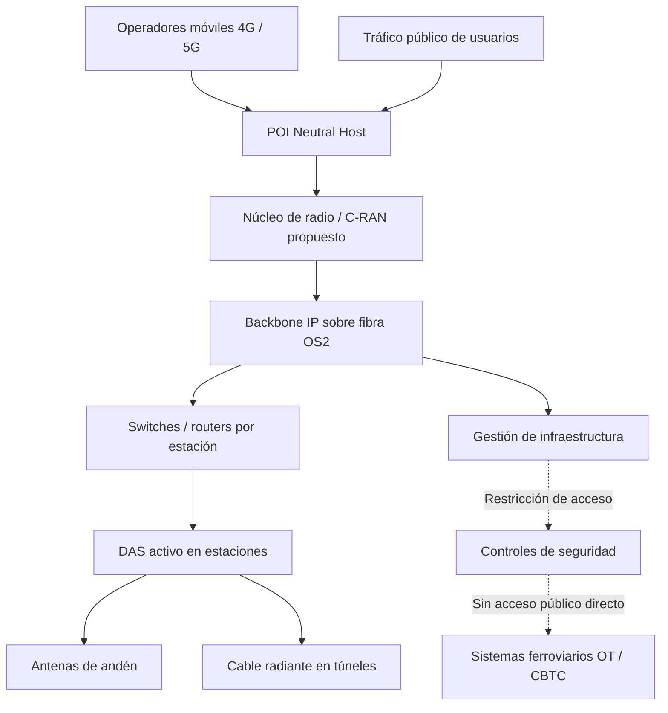
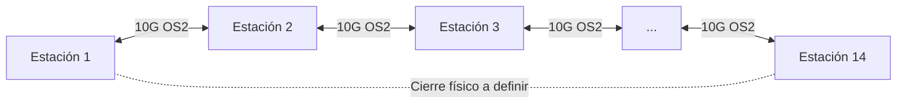

<div align="center">

# 🚇 LÍNEA 9 | METRO DE SANTIAGO

### Infraestructura de Telecomunicaciones Subterránea 4G/5G

**Arquitectura 5G SA Neutral Host · C-RAN · DAS activo · Cable radiante · Backbone OS2 · Seguridad IT/OT**


**Ingeniería en Conectividad y Redes · Duoc UC, sede San Joaquín**

</div>

---

## 📑 Contenido

1. [Resumen del proyecto](#-resumen-del-proyecto)
2. [Problema y alcance](#-problema-y-alcance)
3. [Objetivos](#-objetivos)
4. [Arquitectura de la solución](#-arquitectura-de-la-solución)
5. [Backbone de fibra óptica](#-backbone-de-fibra-óptica)
6. [Dimensionamiento de radiofrecuencia](#-dimensionamiento-de-radiofrecuencia)
7. [Memoria de cálculo óptico](#-memoria-de-cálculo-óptico)
8. [Segmentación y ciberseguridad IT/OT](#-segmentación-y-ciberseguridad-itot)
9. [Simulación y validación](#-simulación-y-validación)
10. [Metodología y planificación](#-metodología-y-planificación)
11. [Entregables y repositorio](#-entregables-y-repositorio)
12. [Riesgos y próximos pasos](#-riesgos-y-próximos-pasos)
13. [Equipo](#-equipo)
14. [Referencias](#-referencias)

---

## 📡 Resumen del proyecto

Este repositorio documenta el desarrollo del **Proyecto Capstone PTY4624**, centrado en el **diseño de una infraestructura de telecomunicaciones para la futura Línea 9 del Metro de Santiago**.

La solución propone habilitar conectividad móvil **4G/5G mediante un modelo *Neutral Host***, compartiendo infraestructura de radio entre operadores y utilizando un sistema de antenas distribuidas (**DAS activo**) en estaciones y **cable radiante (*Leaky Feeder*)** en túneles. El transporte se apoya en fibra óptica monomodo **OS2**, con redes IP redundantes y segmentación de seguridad entre tráfico público y sistemas ferroviarios críticos.

| Parámetro del proyecto | Alcance de diseño |
|:--|:--|
| Extensión referencial | **27 km** |
| Estaciones consideradas | **14** |
| Entorno | Túneles y andenes subterráneos |
| Velocidad de operación considerada | Hasta **80 km/h** |
| Modelo de acceso | **Neutral Host**, multioperador |
| Red de acceso | 4G/5G; foco de diseño 5G SA |
| Distribución RF | DAS activo + cable radiante |
| Transporte | Fibra OS2, enlaces de **10 Gbps** entre estaciones |
| Evolución de capacidad | Alternativas **40G** sujetas a selección de equipos |
| Seguridad | Separación IT/OT y enfoque IEC 62443 |

> **Alcance académico:** se desarrolla una propuesta de ingeniería, dimensionamiento y validación conceptual. Los datos de trazado, tráfico y propagación utilizados como referencia deben contrastarse con antecedentes oficiales y especificaciones de fabricantes antes de una eventual implementación.

## 📍 Problema y alcance

Las estructuras de hormigón, la profundidad de los túneles, las curvas y la geometría de las estaciones dificultan la propagación de señal móvil desde la superficie. Esto puede producir pérdida de cobertura durante el trayecto, afectando navegación, llamadas, mensajería y servicios digitales de los pasajeros.

El proyecto parte de un escenario de alta atenuación subterránea y propone distribuir la señal **dentro de la infraestructura**, en lugar de depender exclusivamente de antenas exteriores.

**Incluye:**

- Diseño de cobertura en andenes y túneles de la Línea 9.
- Integración multioperador mediante un punto de interconexión (*POI*) Neutral Host.
- Arquitectura C-RAN, DAS y cable radiante.
- Backbone IP sobre fibra OS2 y redundancia de enlaces.
- Memorias de cálculo RF y óptica.
- Definición de zonas y políticas para separación IT/OT.
- Simulación IP de laboratorio y plan de pruebas.

**Fuera de alcance:** construcción de la infraestructura, instalación en terreno, operación de estaciones base reales y modificación de **CBTC, señalización, tracción, torniquetes o sistemas ferroviarios de Metro**. La red OT se considera únicamente como dominio que debe permanecer aislado.

## 🎯 Objetivos

### Objetivo general

Diseñar una arquitectura integral de telecomunicaciones subterránea para la Línea 9, combinando acceso móvil 4G/5G, distribución de radio y transporte por fibra óptica, con foco en continuidad de servicio, redundancia y separación de los sistemas ferroviarios críticos.

### Objetivos específicos

1. **Cobertura RF:** dimensionar segmentos de cable radiante y evaluar el presupuesto de enlace en túneles, considerando pérdidas longitudinales, acoplamiento, penetración al tren y margen de desvanecimiento.
2. **Estaciones:** proponer DAS activo para distribuir señal móvil en andenes y recintos definidos en el alcance.
3. **Backbone:** diseñar enlaces ópticos OS2 entre las 14 estaciones, con capacidad base de 10 Gbps y una topología redundante.
4. **Red IP:** definir jerarquía de equipos, enrutamiento OSPF y mecanismos de continuidad de servicio.
5. **Ciberseguridad:** establecer zonas de seguridad y reglas de acceso que impidan tránsito no autorizado entre usuarios públicos, administración de infraestructura y dominio OT.
6. **Validación:** documentar cálculos, escenarios y pruebas de laboratorio, identificando limitaciones y supuestos técnicos.

## 🏗️ Arquitectura de la solución



El dibujo muestra los **bloques funcionales** de la propuesta. La relación física entre unidades de radio, DAS y cable radiante deberá ajustarse a los equipos seleccionados; no representa una implementación de campo.

### Tecnologías consideradas

| Componente | Función |
|:--|:--|
| **Neutral Host / POI** | Compartir infraestructura de acceso entre operadores participantes. |
| **C-RAN** | Centralizar funciones de radio donde resulte técnicamente viable. |
| **DAS activo** | Distribuir la señal de radio en áreas de estación. |
| **Cable radiante** | Entregar cobertura longitudinal en túneles. |
| **Fibra OS2** | Transporte óptico entre recintos técnicos y estaciones. |
| **Switching L3 + OSPF** | Conectividad IP y selección de rutas alternativas. |
| **VRF, VLAN, ACL / firewall** | Segregación de tráfico y políticas de acceso. |
| **QoS** | Clasificación y priorización según servicios autorizados. |

## 🌐 Backbone de fibra óptica

**Los 27 km corresponden a la longitud de la infraestructura**, no necesariamente a un único enlace óptico entre dos transceptores.

La propuesta contempla **enlaces de 10 Gbps entre estaciones**, dimensionados según la distancia real de cada tramo. En cada extremo de un enlace se requiere un transceptor compatible con la fibra, la velocidad, el presupuesto óptico y el equipo de red.



**Criterios de selección:**

- **10GBASE-LR:** referencia para enlaces de hasta **10 km**, sujeto a presupuesto óptico y condiciones del fabricante.
- **10GBASE-ER:** alternativa para enlaces de mayor alcance, con alcance nominal de hasta **40 km** bajo condiciones especificadas.
- **10GBASE-SR:** corresponde a aplicaciones de corta distancia sobre fibra multimodo y **no** se propone como solución para el backbone OS2 de larga distancia.
- Las distancias reales de los segmentos, conectores, empalmes, reserva de ingeniería y transceptores deben verificarse **por enlace**, no solo para el trazado total.

### Redundancia y cantidad preliminar de módulos

Se contempla una **arquitectura de doble anillo** como objetivo de diseño, con doble núcleo de red. Como dimensionamiento de referencia, **dos anillos independientes de 14 enlaces** implicarían **28 enlaces y 56 transceptores** (dos por enlace). Esa cantidad **no constituye un inventario definitivo**: depende de recorridos físicos, enlaces de cierre, redundancia efectiva, topología seleccionada y puertos disponibles.

La convergencia de rutas mediante OSPF se evaluará en laboratorio. No se declara un tiempo de reconvergencia hasta disponer de mediciones.

## 📶 Dimensionamiento de radiofrecuencia

La memoria RF evalúa un **sector de diseño de 350 m** de cable radiante, con frecuencia de referencia de **3,5 GHz**. Los parámetros son los del libro de cálculo del equipo y requieren validación con la ficha del cable y la arquitectura RF seleccionada.

| Parámetro | Valor de trabajo |
|:--|--:|
| Potencia de transmisión de referencia | **43 dBm** |
| Pérdida POI / combinador | **3,5 dB** |
| Jumpers y conectores | **1,5 dB** |
| Longitud del sector | **350 m** |
| Atenuación longitudinal | **6,8 dB / 100 m** |
| Pérdida longitudinal acumulada | **23,8 dB** |
| Pérdida de acoplamiento | **72 dB** |
| Penetración al vagón | **10 dB** |
| Reserva por desvanecimiento | **4 dB** |

### Balance RF de referencia

```text
Pr = 43 - 3,5 - 1,5 - 23,8 - 72 - 10 - 4
Pr = -71,8 dBm

Referencia de comparación = -75 dBm
Margen simplificado = -71,8 - (-75) = +3,2 dB
```

El margen es **reducido**. Un escenario de sensibilidad que agrega **5 dB de pérdidas** transforma el margen en **−1,8 dB**, lo que demuestra la necesidad de revisar longitud de los sectores, características de acoplamiento y reservas.

> **Interpretación:** el resultado de −71,8 dBm es la salida de un *balance RF simplificado*; **no debe presentarse como RSRP 5G medido** ni como garantía de cobertura continua. La validación RF completa requiere especificaciones de radio, antenas/cable, bandas, geometría del túnel, movilidad y planificación de señal.

## 🔌 Memoria de cálculo óptico

La hoja óptica inicial evalúa un **escenario teórico extremo a extremo de 27 km** y lo compara con el presupuesto disponible definido en la planilla.

| Concepto | Pérdida calculada |
|:--|--:|
| Fibra OS2: 27 km × 0,35 dB/km | **9,45 dB** |
| Empalmes: 14 × 0,05 dB | **0,70 dB** |
| Conectores | **1,20 dB** |
| Reserva de ingeniería | **1,50 dB** |
| **Total** | **12,85 dB** |
| Presupuesto óptico supuesto | **14,40 dB** |
| **Margen teórico** | **+1,55 dB** |

```text
Pérdida fibra = distancia × atenuación por km
Pérdida total = fibra + fusiones + conectores + reserva
Margen = presupuesto óptico disponible - pérdida total
```

**Consideración esencial:** que el margen de potencia sea positivo **no acredita que un módulo 10GBASE-LR soporte 27 km continuos**. Por eso se diferencia entre:

| Escenario | Uso en el diseño |
|:--|:--|
| **2 km** | Ejemplo de cálculo de enlace entre estaciones. |
| **10 km** | Distancia nominal de referencia para analizar 10GBASE-LR. |
| **27 km** | Caso extremo a extremo para sensibilidad; requiere ópticas acordes o regeneración/interconexión entre estaciones. |

El siguiente paso de ingeniería es calcular **cada tramo real entre estaciones** e identificar el transceptor correspondiente. Los parámetros de potencia de transmisión y sensibilidad se sustituirán por los de módulos comerciales concretos.

## 🔐 Segmentación y ciberseguridad IT/OT

La propuesta toma como referencia **IEC 62443**, particularmente el enfoque de **zonas y conductos** de IEC 62443-3-2, para organizar los dominios de red y controlar sus interconexiones.

### Zonas definidas

| Zona | Función | Tratamiento propuesto |
|:--|:--|:--|
| **Z-PUB** | Tráfico público de usuarios 4G/5G | Dominio público separado. |
| **Z-DAS** | Gestión de unidades DAS / radio | Acceso desde administración autorizada. |
| **Z-NET** | Gestión de switches y routers | Administración restringida. |
| **Z-SEC** | Servicios de seguridad y monitoreo | Gestión centralizada, registros y control. |
| **Z-OT** | Control ferroviario y CBTC | Dominio externo y aislado de la solución pública. |
| **Z-EXT** | Operadores y servicios externos | Interconexión controlada mediante interfaces autorizadas. |

### Políticas principales

| Origen → Destino | Política |
|:--|:--|
| Público → OT/CBTC | **DENEGAR** |
| Público → Gestión DAS o backbone | **DENEGAR** |
| Administración de seguridad → Equipos de gestión | **PERMITIR RESTRINGIDO** |
| Backbone / DAS → OT/CBTC | **DENEGAR** |
| Operadores externos → Gestión de red | **DENEGAR por defecto** |
| Usuarios públicos → Servicios de operador | **PERMITIR según servicios y controles** |

Se prevé segmentación mediante VRF/VLAN donde corresponda, reglas de filtrado y principio de mínimo privilegio. **Las VLAN y subredes del archivo de seguridad son identificadores de laboratorio**, no direcciones de redes reales de Metro de Santiago. Las políticas son de diseño y aún requieren validación funcional.

## 🧪 Simulación y validación

La simulación de red se desarrolla en **Cisco Packet Tracer** y se enfoca en **conectividad IP, enrutamiento, redundancia y restricciones de acceso**. El entorno no reproduce propagación radioeléctrica 5G ni el comportamiento físico del DAS y del cable radiante.

| Prueba propuesta | Criterio de verificación | Estado |
|:--|:--|:--|
| Conectividad entre segmentos autorizados | Ping o prueba de servicio permitida | 🔄 En desarrollo |
| Rutas OSPF | Verificación de vecinos y rutas | 🔄 En desarrollo |
| Pérdida de enlace y ruta alternativa | Comprobar recuperación y registrar tiempos reales | ⏳ Pendiente |
| Acceso público a gestión | Bloqueo del tráfico no autorizado | ⏳ Pendiente |
| Separación del dominio OT | Ausencia de ruta pública hacia red OT de prueba | ⏳ Pendiente |
| Evidencias | Archivo `.pkt`, capturas y resultados documentados | ⏳ Pendiente |

**No se consideran resultados comprobados** las metas de convergencia inferiores a 500 ms ni latencias específicas sin capturas, registros y condiciones de prueba.

## 🛠️ Metodología y planificación

Se utiliza un enfoque combinado:

- **PPDIOO (Cisco):** preparación, planificación, diseño, implementación de laboratorio, operación/validación y optimización.
- **Gestión iterativa:** distribución de responsabilidades, avances por hitos, control de versiones y entrega de evidencias técnicas.

### Carta Gantt del proyecto

Planificación de referencia de la presentación original, distribuida en **17 semanas** (agosto–diciembre de 2026):

| Actividad | Semanas | Fechas planificadas |
|:--|:--:|:--|
| Definición del problema, alcance y objetivos | 1–2 | 10–23 ago |
| Levantamiento de requisitos y normativas | 3–4 | 24 ago–6 sep |
| Metodología e hitos | 5 | 7–13 sep |
| Arquitectura lógica y diseño de red | 6–7 | 14–27 sep |
| Dimensionamiento técnico y enlace RF | 8–9 | 28 sep–11 oct |
| Modelo CAPEX/OPEX | 10–11 | 12–25 oct |
| Integración de propuestas | 12 | 26 oct–1 nov |
| Simulación y validación conceptual | 13–14 | 2–15 nov |
| Documentación técnica final | 15 | 16–22 nov |
| Preparación de defensa | 16 | 23–29 nov |
| Defensa final | 17 | 30 nov–6 dic |

**Corte documental: 16 de noviembre de 2026.** La matriz de cálculo y seguridad están disponibles; la simulación Packet Tracer continúa en desarrollo. Los porcentajes originales de avance no se reutilizan como resultados verificables si no están respaldados por archivos o pruebas.

## 📂 Entregables y repositorio

### Evidencias del proyecto

| Entregable | Archivo de trabajo | Estado al 16-11-2026 |
|:--|:--|:--|
| Memoria de cálculo RF y óptico | `Dimensionamiento_5G_Linea_9_REVISION_TECNICA.xlsx` | ✅ Disponible; parámetros por validar |
| Matriz de seguridad IT/OT | `Matriz_Seguridad_IT_OT_Linea9.xlsx` | ✅ Disponible; pruebas pendientes |
| Presentación de avance | `Capstone_Linea9_Presentacion_Final_17-11-2026.pptx` | ✅ Preparada; falta insertar simulación |
| Simulación de arquitectura IP | Archivo `.pkt` | 🔄 En desarrollo |
| Informe técnico integrado | Documento de arquitectura | ⏳ Por consolidar |
| Topología física y lógica detallada | Diagrama / exportación | ⏳ Por completar |
| Registro de pruebas | Evidencias del `.pkt` | ⏳ Por completar |

### Organización sugerida del repositorio

> Estructura de destino: crear estas carpetas y subir los documentos si aún no existen. No implica que todos estos archivos estén actualmente publicados en GitHub.

```text
Linea9-Metro/
├── README.md
├── calculos/
│   └── Dimensionamiento_5G_Linea_9_REVISION_TECNICA.xlsx
├── seguridad/
│   └── Matriz_Seguridad_IT_OT_Linea9.xlsx
├── simulacion/
│   ├── linea9_topologia.pkt              # Cuando esté terminada
│   └── evidencias/                      # Capturas y pruebas
├── arquitectura/
│   └── diagramas/                       # Topología física/lógica
├── documentacion/
│   └── informe_tecnico.pdf              # Al consolidar el informe
└── presentacion/
    └── Capstone_Linea9_Presentacion_Final_17-11-2026.pptx
```

## ⚠️ Riesgos y próximos pasos

| Riesgo | Medida de control |
|:--|:--|
| Pérdidas RF mayores a las previstas | Revisar el *link budget* y seleccionar cable radiante con datos de fabricante a 3,5 GHz. |
| Cobertura insuficiente dentro del vagón | Evaluar penetración, distribución RF y requisitos de cobertura reales. |
| Selección de módulo óptico fuera de alcance nominal | Calcular pérdidas y distancia **por tramo**; evaluar LR o ER según necesidad. |
| Fallas en backbone o núcleo | Diseñar diversidad de rutas y validar recuperación OSPF en la simulación. |
| Accesos no autorizados desde tráfico público | Mantener separación IT/OT, aplicar filtrado y verificar pruebas negativas. |
| Diferencia entre resultado teórico y funcionamiento real | Registrar supuestos, fichas técnicas y condiciones de prueba. |

**Próximas tareas:** cerrar la topología Packet Tracer, registrar pruebas, identificar los recorridos ópticos definitivos, seleccionar referencias comerciales de equipos RF/ópticos e integrar los entregables en el informe técnico.

## 👥 Equipo

| Integrante | Área principal |
|:--|:--|
| **Víctor Arriagada** | Topología L3, integración IP y redundancia de núcleo |
| **Martín Devia** | Ingeniería RF y cable radiante |
| **Sebastián Jara** | Arquitectura C-RAN y presupuesto de enlace |
| **Emilio Yáñez** | Seguridad lógica, segmentación IT/OT e IEC 62443 |

**Carrera:** Ingeniería en Conectividad y Redes  
**Asignatura:** Proyecto Capstone — PTY4624  
**Institución:** Duoc UC, sede San Joaquín  
**Docente:** Claudia Gabriela Reinoso Hurtado

## 📚 Referencias

- [ISA/IEC 62443 — Serie de seguridad de sistemas de automatización y control](https://www.isa.org/standards-and-publications/isa-standards/isa-iec-62443-series-of-standards)
- [ISA/IEC 62443-3-2 — Documento de referencia](https://www.isa.org/getmedia/661c718f-8e64-446d-acf9-2c6286db1b33/isa-62443-3-2-preview.pdf)
- [Cisco — Transceptores ópticos](https://www.cisco.com/c/en/us/products/interfaces-modules/transceiver-modules/index.html)
- **Memoria de cálculo del equipo:** `Dimensionamiento_5G_Linea_9_REVISION_TECNICA.xlsx`.
- **Matriz de seguridad del equipo:** `Matriz_Seguridad_IT_OT_Linea9.xlsx`.
- **Presentación EV3:** base de la Carta Gantt, arquitectura y responsables del proyecto.

---

<div align="center">

**Proyecto Capstone Línea 9 · Ingeniería en Conectividad y Redes · 2026**

*Diseño de conectividad subterránea, alta disponibilidad y seguridad de redes.*

</div>
